# Capítulo VII: Product Implementation, Validation & Deployment

VetPax es una solución digital de **PawVital Tech** orientada al seguimiento clínico, nutricional y terapéutico de mascotas geriátricas o con enfermedades crónicas. Está integrada por una Landing Page, una aplicación web Angular, una aplicación móvil Flutter y servicios REST en ASP.NET Core/.NET 10. El backend sigue DDD, separación por capas y un monolito modular con componentes de dominio, aplicación, infraestructura e interfaz. Para autenticar y autorizar se ha configurado Keycloak; para alojar la API y servicios complementarios se emplea Railway.

El capítulo documenta el proceso de configuración, implementación, pruebas, despliegue y validación. Las capturas incluyen estados del proyecto en fechas concretas; no sustituyen la evidencia de funcionamiento actual de todas las integraciones.

## 7.1. Software Configuration Management

La gestión de configuración define los productos, dependencias, repositorios, convenciones y procedimientos necesarios para reproducir el trabajo del equipo. Cada producto digital se mantiene en su repositorio y se relaciona con las historias planificadas mediante Jira y con sus cambios a través del historial Git.

### 7.1.1. Software Development Environment Configuration

Para implementar VetPax se han identificado las siguientes herramientas y dependencias de desarrollo. Las versiones se toman de los archivos de proyecto cuando están disponibles; en los demás casos se indica que están por comprobar.

| Categoría | Software / versión comprobable | Propósito | Referencia |
|---|---|---|---|
| Desarrollo backend | .NET 10, C#, ASP.NET Core Web API | Implementar servicios REST, reglas de aplicación y endpoints HTTP | https://dotnet.microsoft.com/ |
| IDE y ejecución de pruebas | JetBrains Rider (versión pendiente) | Edición y ejecución de pruebas del backend | https://www.jetbrains.com/rider/ |
| ORM y base de datos | Entity Framework Core; Pomelo.EntityFrameworkCore.MySql 9.0.0; MySQL | Persistencia de datos de negocio y migraciones | https://learn.microsoft.com/ef/core/ |
| Identidad | Keycloak, OpenID Connect / OAuth 2.0 | Autenticación, realms, clientes, roles y tokens | https://www.keycloak.org/ |
| Base de datos de identidad | PostgreSQL | Persistencia independiente del servidor Keycloak | https://www.postgresql.org/ |
| Backend — documentación | Swagger / OpenAPI | Especificar y explorar el contrato de la API | https://swagger.io/ |
| Backend — pruebas | xUnit 2.9.3, NUnit3TestAdapter 6.3.1, Reqnroll.NUnit 3.3.4, NSubstitute 6.2.0, Microsoft.AspNetCore.Mvc.Testing 10.0.13 | Pruebas automatizadas, escenarios BDD y sustitución de dependencias | https://xunit.net/ ; https://reqnroll.net/ |
| Web Application | Angular 21.2.x, TypeScript 5.9.x, Angular Material 21.2.x, Vitest 4.0.x | Construcción de la aplicación para personal veterinario | https://angular.dev/ |
| Mobile Application | Flutter y Dart (SDK Dart compatible con ^3.12.0) | Aplicación para propietarios de mascotas y conexión a API | https://flutter.dev/ |
| Mobile — seguridad HTTP | `flutter_appauth`, `flutter_secure_storage`, `http` | Inicio de sesión vía proveedor de identidad, persistencia protegida de token y comunicación REST | https://pub.dev/ |
| Landing Page | HTML5, CSS3, JavaScript, Vite 6.x | Sitio informativo y acceso a flujos de captación | https://vite.dev/ |
| Gestión de código | Git y GitHub | Versionamiento, ramas y revisiones | https://github.com/ |
| Gestión de trabajo | Jira Software, proyecto `VET` | Product Backlog y tablero de Sprint | https://www.atlassian.com/software/jira |
| Infraestructura y publicación | Docker y Railway | Construcción de imagen y despliegue de API, Keycloak y bases de datos | https://railway.com/ |
| Diseño y documentación | Figma, UXPressia, Miro, Structurizr | UX, análisis de usuarios y arquitectura | https://www.figma.com/ ; https://structurizr.com/ |

El backend está separado en `VetPax.Domain` (entidades y reglas de negocio), `VetPax.Application` (casos de uso y handlers), `VetPax.Infrastructure` (persistencia y adaptadores), `VetPax.Api` (controladores y configuración HTTP) y `tests/VetPax.Tests` (pruebas). Los módulos observados incluyen `IdentityAccessManagement`, `ClinicManagement`, `PetClinicalCare`, `AppointmentManagement`, `MedicationTreatment`, `NutritionManagement` y `AdherenceGamification`.

En la aplicación web, `package.json` contiene `ng build` y `ng test`, así como Angular Material y Vitest. La aplicación móvil incluye una prueba Dart en `test/vetpax_api_test.dart` con simulación de respuestas HTTP; esto acredita existencia del código de prueba, no necesariamente su ejecución final. La Landing Page contiene Vite y `netlify.toml`; su publicación se evidencia adicionalmente mediante las 24 capturas de navegador (13 de escritorio y 11 móviles) en la dirección `https://vetpax-landing-page.netlify.app/`.

**Figura 7.1.** Configuración de realm y clientes en Keycloak.


### 7.1.2. Source Code Management

El proyecto utiliza cinco repositorios públicos de la organización PawVital Tech. Para documentar el progreso se revisaron **todas las ramas visibles** de cada repositorio, no solamente `main`: **40 ramas en total** (10 Backend, 9 Web, 10 Mobile, 1 Landing Page y 10 Report). La consulta de los historiales se realizó el **12 de noviembre de 2026, hora de Lima**.

| Producto | Repositorio |
|---|---|
| Informe | [VetPax-Report](https://github.com/1ASI0728-2620-9061-G4-PawVitalTech/VetPax-Report) |
| Backend API y pruebas | [VetPax-Backend](https://github.com/1ASI0728-2620-9061-G4-PawVitalTech/VetPax-Backend) |
| Web Application | [VetPax-Web_Application](https://github.com/1ASI0728-2620-9061-G4-PawVitalTech/VetPax-Web_Application) |
| Mobile Application | [VetPax-Mobile_Application](https://github.com/1ASI0728-2620-9061-G4-PawVitalTech/VetPax-Mobile_Application) |
| Landing Page | [VetPax-Landing_Page](https://github.com/1ASI0728-2620-9061-G4-PawVitalTech/VetPax-Landing_Page) |

**Inventario de ramas realmente identificadas en GitHub**

| Repositorio | Cantidad | Ramas observadas |
|---|---:|---|
| [VetPax-Backend](https://github.com/1ASI0728-2620-9061-G4-PawVitalTech/VetPax-Backend) | 10 | `main`, `develop`, `feature/IAM`, `feature/adherence`, `feature/appointments`, `feature/authentication`, `feature/clinic`, `feature/deployment`, `feature/feeding`, `feature/medication` |
| [VetPax-Web_Application](https://github.com/1ASI0728-2620-9061-G4-PawVitalTech/VetPax-Web_Application) | 9 | `main`, `develop`, `feature/adherence-gamification`, `feature/appointment-management`, `feature/clinic-management`, `feature/dashboard`, `feature/medication-treatment`, `feature/nutrition-management`, `feature/pet-clinical-care` |
| [VetPax-Mobile_Application](https://github.com/1ASI0728-2620-9061-G4-PawVitalTech/VetPax-Mobile_Application) | 10 | `main`, `develop`, `feature/adherence`, `feature/appointments`, `feature/clinics`, `feature/dashboard`, `feature/pets`, `feature/profile`, `feature/treatments`, `feature/vetpax` |
| [VetPax-Landing_Page](https://github.com/1ASI0728-2620-9061-G4-PawVitalTech/VetPax-Landing_Page) | 1 | `main` |
| [VetPax-Report](https://github.com/1ASI0728-2620-9061-G4-PawVitalTech/VetPax-Report) | 10 | `main`, `develop`, `feature/chapter-1`, `feature/chapter-2`, `feature/chapter-3`, `feature/chapter-4`, `feature/chapter-5`, `feature/chapter-6`, `feature/chapter-7`, `feature/frontmatter` |

**Estrategia de integración y control de versiones.** `feature/*` conserva los commits de desarrollo por capacidad; `develop` reúne cambios integrados y `main` representa una referencia de publicación. GitHub muestra además pull requests de incorporación hacia `develop` o `main`, aunque no todas las ramas funcionales se han fusionado. La evidencia de desarrollo debe consultarse en **la rama donde se generó el commit**, ya que una rama principal puede permanecer sin nuevos commits aunque existan funcionalidades implementadas en `feature/*`.

Se observaron, entre otros, el **PR #9 del Backend** (`feature/deployment` hacia `develop`, 04/11), el **PR #19 del Backend** (`feature/authentication` hacia `develop`, 04/11), el **PR #20 del Backend** (`develop` hacia `main`, 04/11) y el **PR #1 de Web** (`develop` hacia `main`, registrado el **13/11 UTC**, equivalente al **12/11, 21:03, hora de Lima**). En el repositorio del informe, el PR #24 incorporó `feature/chapter-7` a `develop` el **23/10**, antes del Sprint 1. Esos merges son hechos de integración y **no deben contabilizarse como implementaciones independientes de los commits que ya incorporan**.

Los mensajes de los cambios se ajustan en buena parte a **Conventional Commits** (`feat`, `fix`, `test`, `style`, `chore`, `build` y scopes como `auth` o `dashboard`). También existen mensajes de merge y commits documentales con formatos distintos: no se afirma uniformidad absoluta. Se proponen las ramas `release/<version>` y `hotfix/<issue>` como convenciones del flujo, pero no se encontraron ramas de esos tipos en el inventario consultado. Para versionado publicable se mantiene la referencia a Semantic Versioning (`MAJOR.MINOR.PATCH`), sin atribuir etiquetas o releases no verificados.

**Trazabilidad detallada.** En **7.2.1.3** se documentan las 40 ramas con un commit real de referencia por rama, las fechas, los autores visibles en GitHub y ejemplos adicionales de commits anteriores a la fusión. En **7.2.1.8** se relaciona este historial con las capturas de GitHub Insights. Estas cifras describen el estado del repositorio al corte de revisión y no sustituyen el Sprint Backlog de Jira.

### 7.1.3. Source Code Style Guide & Conventions

La nomenclatura técnica se expresa en inglés y busca garantizar un estilo consistente. Para C# se utilizan clases y métodos públicos en `PascalCase`, parámetros y variables en `camelCase`, campos privados con `_camelCase` e interfaces con prefijo `I`. Las responsabilidades del dominio se mantienen separadas de los controladores y de los adaptadores de infraestructura. La lógica de casos de uso pertenece a Application y los controllers REST actúan como capa de entrada.

| Lenguaje / elemento | Convención | Ejemplo del dominio o formato |
|---|---|---|
| C#: clase o handler | `PascalCase` y sufijo descriptivo | `RegisterPetCommandHandler` |
| C#: interfaz | `I` + `PascalCase` | `IPetRepository` |
| C#: parámetro | `camelCase` | `petId` |
| C#: campo privado | `_camelCase` | `_repository` |
| TypeScript: componentes | `PascalCase` | `PatientListComponent` (ejemplo de estilo) |
| TypeScript: archivos | `kebab-case` | `patient-list.component.ts` |
| Dart: clases/widgets | `UpperCamelCase` | `LoginPage` |
| Dart: archivos | `snake_case` | `login_page.dart` |
| REST: recursos | Plurales y rutas en inglés | `/api/v1/pets`, `/api/v1/appointments` |
| Git: rama funcional | `feature/<capability>` | `feature/authentication` |
| Git: commit | Conventional Commits | `feat(auth): ...` |

La implementación disponible utiliza rutas HTTP bajo el prefijo `/api/v1/`. En las pruebas de aceptación se trabaja con Gherkin y Reqnroll. **Observación de consistencia:** cinco archivos `.feature` usan `# language: es` y pasos en español, mientras que `MedicationTreatmentApi.feature` usa `Feature/Scenario/Given/When/Then` en inglés. La guía del curso pide nomenclatura en inglés: se recomienda normalizar o justificar la excepción, sin alterar la intención de las pruebas ni afirmar que el cambio ya está realizado.

### 7.1.4. Software Deployment Configuration

**Infraestructura observada.** Las capturas de Railway muestran un entorno denominado `production` con cuatro servicios: `VetPax-Api`, `keycloak`, `MySQL` y `Postgres`, indicados como *Online* en el momento de la captura. El README del backend distingue **MySQL para datos de negocio** y **PostgreSQL para Keycloak**. Railway centraliza variables de entorno de dichos servicios; sus valores deben mantenerse secretos.

| Servicio | Responsabilidad | Evidencia disponible |
|---|---|---|
| `VetPax-Api` | Servicio REST ASP.NET Core/.NET 10 | Proyecto Railway, variables y repositorio/imagen Docker |
| `MySQL` | Persistencia de datos de VetPax | Servicio y variables Railway |
| `keycloak` | Proveedor de autenticación/autorización | Servicio Railway y configuración de realm/clientes |
| `Postgres` | Persistencia del servidor Keycloak | Servicio Railway y variables |

**Figura 7.2.** Servicios registrados en el entorno production de Railway.

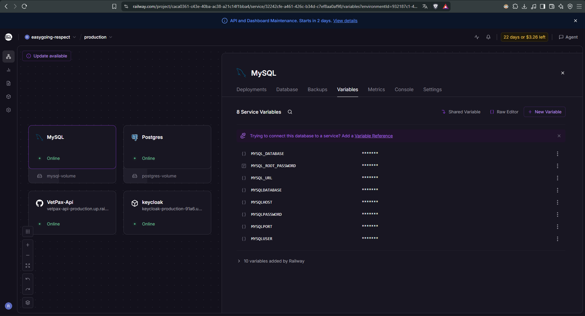

**Figura 7.3.** Configuración de variables del servicio VetPax-Api. Los valores se ocultan por seguridad.

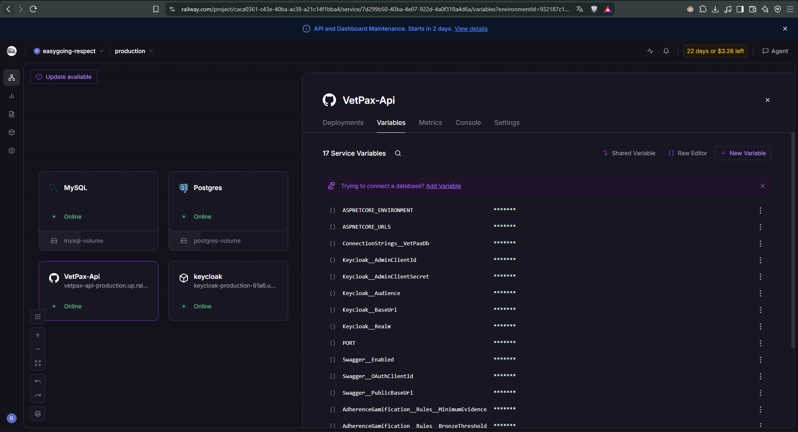

**Figura 7.4.** Clientes de autenticación en el realm de Keycloak.


El despliegue de la API se respalda con un `Dockerfile` versionado en el backend. La Landing Page tiene publicación documentada en Netlify mediante capturas de ejecución. La preparación reproducible comprende: (1) mantener un repositorio de código integrado y construir la aplicación; (2) configurar servicios Railway; (3) aportar de forma protegida las variables de conexión y configuración de identidad; (4) desplegar los contenedores; (5) comprobar el estado del servicio; (6) validar por HTTPS un endpoint de salud/documentación y una solicitud autenticada con roles; (7) actualizar el diagrama C4 de despliegue con las conexiones reales. Existen capturas del estado *Online* de los servicios en Railway y evidencia de publicación de la Landing Page en Netlify. Estas capturas acreditan los estados observados en sus respectivas fechas; una solicitud HTTP autenticada en producción y el diagrama de despliegue definitivo son verificaciones distintas.

En Keycloak se ha configurado el realm de VetPax, roles como `owner`, `veterinarian` y `clinic_administrator`, clientes OpenID Connect y un *audience mapper* para la API. La imagen de Postman muestra un intento de autorización que termina en timeout; no demuestra un inicio de sesión satisfactorio. Por ello, la autenticación completa entre aplicación web/móvil, Keycloak y backend se debe acreditar adicionalmente.

**Figura 7.5.** Mapper de audiencia configurado para el cliente de API.


**Enlaces de referencia:** Landing Page publicada: https://vetpax-landing-page.netlify.app/ ; documentación Swagger configurada: https://vetpax-api-production.up.railway.app/swagger/ . Se dispone de capturas de Railway y Keycloak, pero no de una ejecución autenticada documentada con request/response ni de un diagrama C4 de despliegue final dentro del material revisado. Las credenciales, client secrets y cadenas de conexión no deben publicarse en el informe.

## 7.2. Solution Implementation

**Alcance de esta entrega.** Se documenta únicamente **Sprint 1**, desde el **27 de octubre hasta el 13 de noviembre de 2026**. Su alcance en Jira está formado por **US15, US16, US19 y TS11 (10 Story Points)**, pertenecientes a EP06. Los avances de otros módulos se muestran solo como contexto técnico acumulado y no se atribuyen a estas cuatro historias sin evidencia de trazabilidad.

### 7.2.1. Sprint 1

Las evidencias de esta iteración proceden de Jira, repositorios GitHub, capturas de la Landing Page publicada en Netlify, pruebas del backend en JetBrains Rider y capturas de la infraestructura en Railway y Keycloak. Cada evidencia se identifica por lo que efectivamente demuestra: **una captura visual no equivale a una prueba automatizada**, y un commit de otro módulo no equivale a la entrega de una historia del Sprint Backlog.

#### 7.2.1.1. Sprint Planning 1

La reunión de planificación se realizó el **27 de octubre de 2026, a las 08:00 PM, por Discord**. Fue preparada por Rafael Alexander Dominguez Vargas (Team Leader), con la asistencia de todos los integrantes. Se acordó una capacidad planificada de **10 Story Points** y un objetivo centrado en presentar VetPax, registrar interesados y facilitar el acceso al producto desde la Landing Page.

| Campo | Información |
|---|---|
| Sprint # | Sprint 1 |
| Sprint Start Date | 2026-10-27 |
| Sprint End Date | 2026-11-13 |
| Planning Background Date | 2026-10-27 |
| Time | 08:00 PM |
| Location | Virtual – Discord |
| Prepared By | Rafael Alexander Dominguez Vargas (Team Leader) |
| Attendees | Rafael Alexander Dominguez Vargas, Esteban Valentino Alvarez Falen, Henry Kevin Diaz Gutierrez y Adrian Emanuel Valerio Garcia |
| Sprint 0 Review Summary | No aplica; primera iteración. |
| Sprint 0 Retrospective Summary | No aplica; primera iteración. |
| Sprint 1 Goal | Implementar una primera versión funcional de la Landing Page de VetPax para presentar la solución, permitir el registro de interesados y ofrecer accesos a los productos digitales. |
| Sprint 1 Goal Metric | Completar US15, US16, US19 y TS11 y verificar sus respectivos criterios de aceptación. Esta es la métrica acordada, no una afirmación de que todas las verificaciones ya se realizaron. |
| Sprint 1 Velocity (planned) | 10 Story Points |
| Sum of Story Points selected | 10 Story Points (3 + 2 + 2 + 3) |

| Jira ID | Historia | Story Points | Estado mostrado en el tablero |
|---|---|---:|---|
| VET-6 | US15 – Landing Page informativa | 3 | Finalizado |
| VET-43 | US16 – Registrar interés | 2 | Finalizado |
| VET-44 | US19 – Acceder al producto desde la Landing Page | 2 | Finalizado |
| VET-45 | TS11 – API para registro de interesados | 3 | Finalizado |

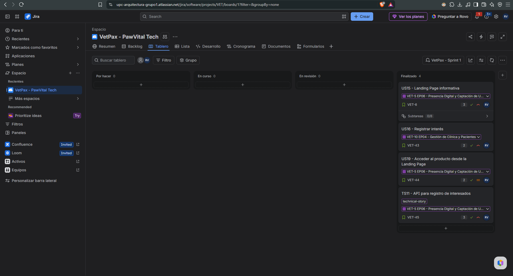

*Figura 7.6. Tablero de Jira «VetPax - Sprint 1» con cuatro historias en la columna Finalizado. Este estado administrativo no sustituye la comprobación de los criterios de aceptación.*

#### 7.2.1.2. Sprint Backlog 1

El Sprint Backlog 1 corresponde a cuatro historias de **EP06 – Presencia Digital y Captación de Usuarios**. La captura de Jira acredita sus identificadores, estimaciones relativas y estado en el tablero. Para detallar actividades se conserva el desglose del documento de trabajo; **los identificadores `WI-*`, las horas y la asignación individual son propuestas de documentación**, no subtareas Jira verificadas. El marcador `Por validar` se refiere exclusivamente a esos work-items, no al estado de las historias principales.

**Tabla. Sprint Backlog 1 – Desglose de work-items propuestos**

| User Story ID | User Story Title | Work-item ID | Work-item Title | Description | Estimation (Hours) | Assigned To | Status |
|---|---|---|---|---|---:|---|---|
| US15 | Landing Page informativa | WI-US15-01 | Implementar sección Hero | Desarrollar la sección principal de presentación de VetPax con su mensaje de valor. | 2 | Rafael Dominguez* | Por validar |
| US15 | Landing Page informativa | WI-US15-02 | Implementar presentación de VetPax | Incorporar información sobre el producto y los segmentos objetivo. | 2 | Rafael Dominguez* | Por validar |
| US15 | Landing Page informativa | WI-US15-03 | Implementar sección de funcionalidades clínicas | Presentar las principales capacidades de seguimiento clínico de VetPax. | 3 | Rafael Dominguez* | Por validar |
| US15 | Landing Page informativa | WI-US15-04 | Implementar sección Appointments | Presentar las funcionalidades relacionadas con las citas veterinarias. | 2 | Rafael Dominguez* | Por validar |
| US15 | Landing Page informativa | WI-US15-05 | Implementar sección de beneficios | Mostrar los beneficios de VetPax para propietarios y profesionales veterinarios. | 2 | Rafael Dominguez* | Por validar |
| US15 | Landing Page informativa | WI-US15-06 | Implementar Navbar y Footer | Desarrollar los componentes de navegación y pie de página. | 3 | Rafael Dominguez* | Por validar |
| US15 | Landing Page informativa | WI-US15-07 | Adaptar Landing Page a dispositivos móviles | Implementar estilos responsive para diferentes tamaños de pantalla. | 3 | Rafael Dominguez* | Por validar |
| US15 | Landing Page informativa | WI-US15-08 | Realizar pruebas de navegación y visualización | Verificar la visualización de las secciones y la navegación entre ellas. | 2 | Rafael Dominguez* | Por validar |
| US16 | Registrar interés | WI-US16-01 | Implementar formulario de interesados | Crear un formulario para registrar los datos de contacto de visitantes. | 3 | Rafael Dominguez* | Por validar |
| US16 | Registrar interés | WI-US16-02 | Implementar validaciones del formulario | Validar campos obligatorios y formato de correo electrónico. | 3 | Rafael Dominguez* | Por validar |
| US16 | Registrar interés | WI-US16-03 | Integrar formulario con servicio de registro | Conectar el formulario con el servicio de registro de interesados. | 2 | Rafael Dominguez* | Por validar |
| US16 | Registrar interés | WI-US16-04 | Verificar escenarios de registro | Comprobar el comportamiento ante datos válidos, inválidos y duplicados. | 2 | Rafael Dominguez* | Por validar |
| US19 | Acceder al producto desde la Landing Page | WI-US19-01 | Implementar acceso a la aplicación web | Incorporar el enlace de acceso a la aplicación web de VetPax. | 2 | Rafael Dominguez* | Por validar |
| US19 | Acceder al producto desde la Landing Page | WI-US19-02 | Implementar acceso a la aplicación móvil | Incorporar el acceso o enlace correspondiente a la aplicación móvil. | 2 | Rafael Dominguez* | Por validar |
| US19 | Acceder al producto desde la Landing Page | WI-US19-03 | Verificar enlaces de acceso | Comprobar que los enlaces dirijan a los destinos correspondientes. | 2 | Rafael Dominguez* | Por validar |
| TS11 | API para registro de interesados | WI-TS11-01 | Implementar servicio REST de interesados | Desarrollar el servicio encargado de recibir solicitudes de registro de interesados. | 3 | Rafael Dominguez* | Por validar |
| TS11 | API para registro de interesados | WI-TS11-02 | Implementar validaciones del servicio | Validar datos recibidos y controlar los registros duplicados. | 3 | Rafael Dominguez* | Por validar |
| TS11 | API para registro de interesados | WI-TS11-03 | Implementar persistencia de interesados | Incorporar el almacenamiento de la información recibida. | 2 | Rafael Dominguez* | Por validar |
| TS11 | API para registro de interesados | WI-TS11-04 | Verificar respuestas HTTP | Comprobar respuestas para registros exitosos, solicitudes inválidas y duplicados. | 2 | Rafael Dominguez* | Por validar |
| TS11 | API para registro de interesados | WI-TS11-05 | Documentar servicio mediante Swagger | Documentar la operación, los parámetros y las respuestas del servicio REST. | 2 | Rafael Dominguez* | Por validar |

**Lectura de la tabla:** la propuesta suma **47 horas** (US15: 19 h; US16: 10 h; US19: 6 h; TS11: 12 h), cifra distinta de los **10 Story Points** del compromiso de planificación. Los Story Points no se convierten directamente en horas. Las estimaciones individuales y los identificadores definitivos deben contrastarse con Jira antes de presentarlos como registro histórico del sprint.

**Enlaces de trazabilidad:** [US15 / VET-6](https://upc-arquitectura-grupo1.atlassian.net/browse/VET-6), [US16 / VET-43](https://upc-arquitectura-grupo1.atlassian.net/browse/VET-43), [US19 / VET-44](https://upc-arquitectura-grupo1.atlassian.net/browse/VET-44), [TS11 / VET-45](https://upc-arquitectura-grupo1.atlassian.net/browse/VET-45).

#### 7.2.1.3. Development Evidence for Sprint Review

La revisión del desarrollo de VetPax se basa en **los historiales de `feature/*`, `develop` y `main` de los cinco repositorios**, no solo en la rama principal. Se verificaron las **40 ramas** enumeradas en 7.1.2. El intervalo del Sprint 1 es **27/10/2026–13/11/2026, hora de Lima** y el corte de consulta corresponde a la noche del **12/11/2026**. Un commit anterior al 27/10 se registra como línea base; el hecho de que un commit esté dentro de las fechas no significa que su historia forme parte del Sprint Backlog.

**Reglas de interpretación de la evidencia:**

- La columna *Branch* refleja **una rama real en la que el commit es alcanzable**, no necesariamente su única rama ni su rama de creación. La tabla da prioridad a mostrar el commit en la rama funcional que contiene el trabajo.
- Los commits que aparecen tanto en `feature/*` como en `develop` o `main` son el **mismo cambio**: no se suman ni atribuyen varias veces. Los commits `Merge pull request` representan integraciones, no desarrollos funcionales adicionales.
- Los campos de fecha corresponden a **fecha del autor según GitHub, en UTC**. El merge de Web del 13/11 a las 02:03 UTC ocurrió el **12/11 a las 21:03 en Lima**. Los cuerpos de commit sin texto adicional se representan mediante `—`.
- Se muestra **al menos un commit comprobable de cada rama** y, para ramas con actividad relevante, commits adicionales anteriores a su integración. Los enlaces de rama permiten consultar el historial completo en GitHub, sin truncarlo al historial de `main`.

**Backend API — ramas y commits verificados**

| Repository | Branch | Commit ID | Commit Message | Commit Message Body | Committed on (Date UTC) | Autor de GitHub | Alcance / interpretación |
|---|---|---|---|---|---|---|---|
| VetPax-Backend | [`main`](<https://github.com/1ASI0728-2620-9061-G4-PawVitalTech/VetPax-Backend/commits/main>) | [d9574284d8](<https://github.com/1ASI0728-2620-9061-G4-PawVitalTech/VetPax-Backend/commit/d9574284d8>) | Merge pull request #20 from 1ASI0728-2620-9061-G4-PawVitalTech/develop | Develop | 2026-11-04 | Radv2005 | Integración de develop a main |
| VetPax-Backend | [`develop`](<https://github.com/1ASI0728-2620-9061-G4-PawVitalTech/VetPax-Backend/commits/develop>) | [e0655a3391](<https://github.com/1ASI0728-2620-9061-G4-PawVitalTech/VetPax-Backend/commit/e0655a3391>) | Merge pull request #19 from 1ASI0728-2620-9061-G4-PawVitalTech/feature/authentication | — | 2026-11-04 | Radv2005 | Integración de autenticación en develop |
| VetPax-Backend | [`feature/IAM`](<https://github.com/1ASI0728-2620-9061-G4-PawVitalTech/VetPax-Backend/commits/feature/IAM>) | [0afaa4cf31](<https://github.com/1ASI0728-2620-9061-G4-PawVitalTech/VetPax-Backend/commit/0afaa4cf31>) | feat(clinic): remove unused services folder from clinic management module | — | 2026-10-23 | Radv2005 | Último commit de la rama, anterior al sprint |
| VetPax-Backend | [`feature/adherence`](<https://github.com/1ASI0728-2620-9061-G4-PawVitalTech/VetPax-Backend/commits/feature/adherence>) | [507f12eb13](<https://github.com/1ASI0728-2620-9061-G4-PawVitalTech/VetPax-Backend/commit/507f12eb13>) | feat(security): enforce HTTPS redirection in production environment | — | 2026-10-28 | Radv2005 | Cambio realizado durante el sprint |
| VetPax-Backend | [`feature/appointments`](<https://github.com/1ASI0728-2620-9061-G4-PawVitalTech/VetPax-Backend/commits/feature/appointments>) | [f42e67196d](<https://github.com/1ASI0728-2620-9061-G4-PawVitalTech/VetPax-Backend/commit/f42e67196d>) | feat(medication): implement treatment domain and dose tracking | — | 2026-10-24 | Radv2005 | Último commit de la rama, anterior al sprint |
| VetPax-Backend | [`feature/authentication`](<https://github.com/1ASI0728-2620-9061-G4-PawVitalTech/VetPax-Backend/commits/feature/authentication>) | [ce37bde5c5](<https://github.com/1ASI0728-2620-9061-G4-PawVitalTech/VetPax-Backend/commit/ce37bde5c5>) | feat(swagger): configure public API URL for Railway deployment in non-development environments | — | 2026-11-04 | Radv2005 | Desarrollo de autenticación y Swagger antes de integrarse |
| VetPax-Backend | [`feature/clinic`](<https://github.com/1ASI0728-2620-9061-G4-PawVitalTech/VetPax-Backend/commits/feature/clinic>) | [881e732ee9](<https://github.com/1ASI0728-2620-9061-G4-PawVitalTech/VetPax-Backend/commit/881e732ee9>) | test(clinical): add BDD scenarios for authorized clinical access | — | 2026-10-23 | Radv2005 | Último commit de la rama, anterior al sprint |
| VetPax-Backend | [`feature/deployment`](<https://github.com/1ASI0728-2620-9061-G4-PawVitalTech/VetPax-Backend/commits/feature/deployment>) | [47bcbab1fa](<https://github.com/1ASI0728-2620-9061-G4-PawVitalTech/VetPax-Backend/commit/47bcbab1fa>) | build: add Dockerfile for Railway deployment | — | 2026-11-04 | Radv2005 | Dockerfile previo al PR #9 |
| VetPax-Backend | [`feature/feeding`](<https://github.com/1ASI0728-2620-9061-G4-PawVitalTech/VetPax-Backend/commits/feature/feeding>) | [dff2047aa5](<https://github.com/1ASI0728-2620-9061-G4-PawVitalTech/VetPax-Backend/commit/dff2047aa5>) | feat(nutrition): add scheduled feeding reminders with FCM delivery and retries | — | 2026-10-24 | Radv2005 | Último commit de la rama, anterior al sprint |
| VetPax-Backend | [`feature/medication`](<https://github.com/1ASI0728-2620-9061-G4-PawVitalTech/VetPax-Backend/commits/feature/medication>) | [18f76245f6](<https://github.com/1ASI0728-2620-9061-G4-PawVitalTech/VetPax-Backend/commit/18f76245f6>) | feat(medication): add integration tests for medication device token management | — | 2026-10-24 | Radv2005 | Último commit de la rama, anterior al sprint |

**Backend API — commits adicionales de implementación (previos a su integración, cuando corresponde)**

| Branch | Commit ID | Commit Message | Fecha UTC | Autor de GitHub | Función en el desarrollo |
|---|---|---|---|---|---|
| `feature/authentication` | [9eb3f34e65](<https://github.com/1ASI0728-2620-9061-G4-PawVitalTech/VetPax-Backend/commit/9eb3f34e65>) | feat(configuration): enhance OpenAPI setup with Keycloak integration and improve service organization | 2026-11-04 | Radv2005 | OpenAPI/Keycloak en la rama funcional |
| `feature/authentication` | [2083b93f67](<https://github.com/1ASI0728-2620-9061-G4-PawVitalTech/VetPax-Backend/commit/2083b93f67>) | feat(auth): add Keycloak logout functionality and integrate with Swagger UI | 2026-11-04 | Radv2005 | Logout y Swagger antes de integración |
| `feature/authentication` | [a8778da15e](<https://github.com/1ASI0728-2620-9061-G4-PawVitalTech/VetPax-Backend/commit/a8778da15e>) | feat(cors): add CORS configuration for Angular frontend and enhance Keycloak logout handling | 2026-11-04 | Radv2005 | CORS y autenticación antes de integración |
| `feature/authentication` | [9a561f998b](<https://github.com/1ASI0728-2620-9061-G4-PawVitalTech/VetPax-Backend/commit/9a561f998b>) | feat(auth): streamline Keycloak logout process in Swagger UI | 2026-11-04 | Radv2005 | Refinamiento de logout |
| `develop` | [0212554298](<https://github.com/1ASI0728-2620-9061-G4-PawVitalTech/VetPax-Backend/commit/0212554298>) | Merge pull request #9 from 1ASI0728-2620-9061-G4-PawVitalTech/feature/deployment | 2026-11-04 | Radv2005 | Incorporación del Dockerfile a develop |
| `develop` | [e74fc75ca8](<https://github.com/1ASI0728-2620-9061-G4-PawVitalTech/VetPax-Backend/commit/e74fc75ca8>) | Merge pull request #14 from 1ASI0728-2620-9061-G4-PawVitalTech/feature/authentication | 2026-11-04 | Radv2005 | Incorporación de CORS y Keycloak |

En **Backend** pueden seguirse cambios concretos desde `feature/deployment` (`47bcbab1fa`, Dockerfile) hasta el **PR #9** (`0212554298`, merge a `develop`), y desde `feature/authentication` (`9eb3f34e65`, `2083b93f67`, `a8778da15e`, `ce37bde5c5`) hasta los **PR #14 y #19**. Posteriormente el **PR #20** (`d9574284d8`) integró `develop` en `main`. Los trabajos de `feature/IAM`, `feature/appointments`, `feature/clinic`, `feature/feeding` y `feature/medication` figuran en la línea base **anterior al inicio del Sprint 1**, aunque sus resultados puedan utilizarse en el estado del producto observado durante la iteración.


**Web Application (Angular) — ramas y commits verificados**

| Repository | Branch | Commit ID | Commit Message | Commit Message Body | Committed on (Date UTC) | Autor de GitHub | Alcance / interpretación |
|---|---|---|---|---|---|---|---|
| VetPax-Web_Application | [`main`](<https://github.com/1ASI0728-2620-9061-G4-PawVitalTech/VetPax-Web_Application/commits/main>) | [148530917e](<https://github.com/1ASI0728-2620-9061-G4-PawVitalTech/VetPax-Web_Application/commit/148530917e>) | Merge pull request #1 from 1ASI0728-2620-9061-G4-PawVitalTech/develop | Develop | 2026-11-13 (UTC; 12/11 en Lima) | Radv2005 | Integración final de develop a main, 12/11 hora Lima |
| VetPax-Web_Application | [`develop`](<https://github.com/1ASI0728-2620-9061-G4-PawVitalTech/VetPax-Web_Application/commits/develop>) | [c0973c6ab8](<https://github.com/1ASI0728-2620-9061-G4-PawVitalTech/VetPax-Web_Application/commit/c0973c6ab8>) | chore: ignore local Netlify state | — | 2026-11-12 | adrianvalerio13 | Rama de integración, commits de distintos autores |
| VetPax-Web_Application | [`feature/adherence-gamification`](<https://github.com/1ASI0728-2620-9061-G4-PawVitalTech/VetPax-Web_Application/commits/feature/adherence-gamification>) | [d7e33b77ee](<https://github.com/1ASI0728-2620-9061-G4-PawVitalTech/VetPax-Web_Application/commit/d7e33b77ee>) | feat: initial commit - estructura base de VetPax Web | — | 2026-10-28 | Radv2005 | Solo commit inicial compartido; no se acredita implementación específica |
| VetPax-Web_Application | [`feature/appointment-management`](<https://github.com/1ASI0728-2620-9061-G4-PawVitalTech/VetPax-Web_Application/commits/feature/appointment-management>) | [c49d8cb675](<https://github.com/1ASI0728-2620-9061-G4-PawVitalTech/VetPax-Web_Application/commit/c49d8cb675>) | feat: implement appointment management agenda | — | 2026-10-30 | adrianvalerio13 | Agenda de citas en rama funcional |
| VetPax-Web_Application | [`feature/clinic-management`](<https://github.com/1ASI0728-2620-9061-G4-PawVitalTech/VetPax-Web_Application/commits/feature/clinic-management>) | [aaa38c407c](<https://github.com/1ASI0728-2620-9061-G4-PawVitalTech/VetPax-Web_Application/commit/aaa38c407c>) | feat: implement clinic management | — | 2026-10-30 | adrianvalerio13 | Administración de clínicas en rama funcional |
| VetPax-Web_Application | [`feature/dashboard`](<https://github.com/1ASI0728-2620-9061-G4-PawVitalTech/VetPax-Web_Application/commits/feature/dashboard>) | [00fcbf57fb](<https://github.com/1ASI0728-2620-9061-G4-PawVitalTech/VetPax-Web_Application/commit/00fcbf57fb>) | feat(dashboard): customize workspace by user role | — | 2026-11-12 | Valentino10113 | Dashboard y navegación por roles |
| VetPax-Web_Application | [`feature/medication-treatment`](<https://github.com/1ASI0728-2620-9061-G4-PawVitalTech/VetPax-Web_Application/commits/feature/medication-treatment>) | [f850fbb37b](<https://github.com/1ASI0728-2620-9061-G4-PawVitalTech/VetPax-Web_Application/commit/f850fbb37b>) | feat(medication-treatment): implement medication treatment module | — | 2026-11-10 | HenryDiaz12 | Tratamientos y componentes compartidos |
| VetPax-Web_Application | [`feature/nutrition-management`](<https://github.com/1ASI0728-2620-9061-G4-PawVitalTech/VetPax-Web_Application/commits/feature/nutrition-management>) | [a500cefb80](<https://github.com/1ASI0728-2620-9061-G4-PawVitalTech/VetPax-Web_Application/commit/a500cefb80>) | feat(nutrition): add nutrition management pages and routes | — | 2026-11-10 | HenryDiaz12 | Nutrición y pruebas del servicio API en la rama |
| VetPax-Web_Application | [`feature/pet-clinical-care`](<https://github.com/1ASI0728-2620-9061-G4-PawVitalTech/VetPax-Web_Application/commits/feature/pet-clinical-care>) | [1c7ac90457](<https://github.com/1ASI0728-2620-9061-G4-PawVitalTech/VetPax-Web_Application/commit/1c7ac90457>) | feat(clinical): display measured evolution and patient details | — | 2026-11-12 | Valentino10113 | Historial/atención clínica y estados de evolución |

**Web Application (Angular) — commits adicionales de implementación (previos a su integración, cuando corresponde)**

| Branch | Commit ID | Commit Message | Fecha UTC | Autor de GitHub | Función en el desarrollo |
|---|---|---|---|---|---|
| `feature/dashboard` | [3076990af0](<https://github.com/1ASI0728-2620-9061-G4-PawVitalTech/VetPax-Web_Application/commit/3076990af0>) | feat(dashboard): implement role-based navigation | 2026-11-12 | Valentino10113 | Navegación por roles |
| `feature/pet-clinical-care` | [3ac9f45903](<https://github.com/1ASI0728-2620-9061-G4-PawVitalTech/VetPax-Web_Application/commit/3ac9f45903>) | feat(clinical): build clinical attention form | 2026-11-11 | Valentino10113 | Formulario de atención clínica |
| `feature/pet-clinical-care` | [175afeb0ae](<https://github.com/1ASI0728-2620-9061-G4-PawVitalTech/VetPax-Web_Application/commit/175afeb0ae>) | fix(clinical): handle invalid patient IDs and evolution states | 2026-11-12 | Valentino10113 | Corrección de flujos clínicos |
| `feature/nutrition-management` | [e7f5813bef](<https://github.com/1ASI0728-2620-9061-G4-PawVitalTech/VetPax-Web_Application/commit/e7f5813bef>) | test(nutrition): add nutrition API service tests | 2026-11-10 | HenryDiaz12 | Pruebas específicas del módulo nutricional |
| `feature/medication-treatment` | [a27bfa2f9a](<https://github.com/1ASI0728-2620-9061-G4-PawVitalTech/VetPax-Web_Application/commit/a27bfa2f9a>) | feat(auth): implement authentication interceptor | 2026-11-10 | HenryDiaz12 | Interceptor de autorización |
| `develop` | [75a4a6daa4](<https://github.com/1ASI0728-2620-9061-G4-PawVitalTech/VetPax-Web_Application/commit/75a4a6daa4>) | chore: configure Netlify deployment | 2026-11-12 | adrianvalerio13 | Configuración de publicación Web |
| `develop` | [5104a1bd23](<https://github.com/1ASI0728-2620-9061-G4-PawVitalTech/VetPax-Web_Application/commit/5104a1bd23>) | fix: prevent silent Keycloak account reuse | 2026-11-12 | adrianvalerio13 | Corrección de autenticación |
| `develop` | [fa574d6ca8](<https://github.com/1ASI0728-2620-9061-G4-PawVitalTech/VetPax-Web_Application/commit/fa574d6ca8>) | refactor(json): change syntaxis | 2026-11-12 | HenryDiaz12 | Ajustes de integración compartidos |

En **Web**, las ramas `feature/pet-clinical-care`, `feature/medication-treatment`, `feature/nutrition-management` y `feature/dashboard` contienen commits de **Valentino10113** y **HenryDiaz12** que no se deben omitir por revisar solamente `main`. Las ramas `feature/appointment-management` y `feature/clinic-management` muestran commits de **adrianvalerio13**. Las integraciones y ajustes de `develop` incluyen aportes de distintos autores; el **PR #1** integró `develop` hacia `main` el **12/11, hora de Lima**. El commit `d7e33b77ee` de `feature/adherence-gamification` es el inicial compartido: **no prueba por sí solo una función de gamificación web terminada**.


**Mobile Application (Flutter) — ramas y commits verificados**

| Repository | Branch | Commit ID | Commit Message | Commit Message Body | Committed on (Date UTC) | Autor de GitHub | Alcance / interpretación |
|---|---|---|---|---|---|---|---|
| VetPax-Mobile_Application | [`main`](<https://github.com/1ASI0728-2620-9061-G4-PawVitalTech/VetPax-Mobile_Application/commits/main>) | [d6b7eb40a0](<https://github.com/1ASI0728-2620-9061-G4-PawVitalTech/VetPax-Mobile_Application/commit/d6b7eb40a0>) | feat: initial commit - estructura base de VetPax Mobile | — | 2026-10-28 | Radv2005 | Rama principal en la base inicial |
| VetPax-Mobile_Application | [`develop`](<https://github.com/1ASI0728-2620-9061-G4-PawVitalTech/VetPax-Mobile_Application/commits/develop>) | [56fa3ac3d7](<https://github.com/1ASI0728-2620-9061-G4-PawVitalTech/VetPax-Mobile_Application/commit/56fa3ac3d7>) | fix: update API and Keycloak URLs to production endpoints | — | 2026-11-04 | Radv2005 | Integración de URLs de API y Keycloak |
| VetPax-Mobile_Application | [`feature/adherence`](<https://github.com/1ASI0728-2620-9061-G4-PawVitalTech/VetPax-Mobile_Application/commits/feature/adherence>) | [d6b7eb40a0](<https://github.com/1ASI0728-2620-9061-G4-PawVitalTech/VetPax-Mobile_Application/commit/d6b7eb40a0>) | feat: initial commit - estructura base de VetPax Mobile | — | 2026-10-28 | Radv2005 | Solo commit inicial; sin cambio específico identificado |
| VetPax-Mobile_Application | [`feature/appointments`](<https://github.com/1ASI0728-2620-9061-G4-PawVitalTech/VetPax-Mobile_Application/commits/feature/appointments>) | [1f3ef31580](<https://github.com/1ASI0728-2620-9061-G4-PawVitalTech/VetPax-Mobile_Application/commit/1f3ef31580>) | feat: add appointment booking page | — | 2026-11-11 | HenryDiaz12 | Reserva, calendario y pruebas en la rama |
| VetPax-Mobile_Application | [`feature/clinics`](<https://github.com/1ASI0728-2620-9061-G4-PawVitalTech/VetPax-Mobile_Application/commits/feature/clinics>) | [043473a7f3](<https://github.com/1ASI0728-2620-9061-G4-PawVitalTech/VetPax-Mobile_Application/commit/043473a7f3>) | feat: implement clinics feature | — | 2026-11-11 | HenryDiaz12 | Directorio y funciones de clínicas |
| VetPax-Mobile_Application | [`feature/dashboard`](<https://github.com/1ASI0728-2620-9061-G4-PawVitalTech/VetPax-Mobile_Application/commits/feature/dashboard>) | [6482d470e2](<https://github.com/1ASI0728-2620-9061-G4-PawVitalTech/VetPax-Mobile_Application/commit/6482d470e2>) | feat: implement owner dashboard | — | 2026-10-30 | adrianvalerio13 | Dashboard del propietario |
| VetPax-Mobile_Application | [`feature/pets`](<https://github.com/1ASI0728-2620-9061-G4-PawVitalTech/VetPax-Mobile_Application/commits/feature/pets>) | [d6b7eb40a0](<https://github.com/1ASI0728-2620-9061-G4-PawVitalTech/VetPax-Mobile_Application/commit/d6b7eb40a0>) | feat: initial commit - estructura base de VetPax Mobile | — | 2026-10-28 | Radv2005 | Solo commit inicial; sin cambio específico identificado |
| VetPax-Mobile_Application | [`feature/profile`](<https://github.com/1ASI0728-2620-9061-G4-PawVitalTech/VetPax-Mobile_Application/commits/feature/profile>) | [d6b7eb40a0](<https://github.com/1ASI0728-2620-9061-G4-PawVitalTech/VetPax-Mobile_Application/commit/d6b7eb40a0>) | feat: initial commit - estructura base de VetPax Mobile | — | 2026-10-28 | Radv2005 | Solo commit inicial; sin cambio específico identificado |
| VetPax-Mobile_Application | [`feature/treatments`](<https://github.com/1ASI0728-2620-9061-G4-PawVitalTech/VetPax-Mobile_Application/commits/feature/treatments>) | [8d01cd7bf4](<https://github.com/1ASI0728-2620-9061-G4-PawVitalTech/VetPax-Mobile_Application/commit/8d01cd7bf4>) | feat: implement treatments care interface | — | 2026-10-30 | adrianvalerio13 | Pantallas de seguimiento terapéutico |
| VetPax-Mobile_Application | [`feature/vetpax`](<https://github.com/1ASI0728-2620-9061-G4-PawVitalTech/VetPax-Mobile_Application/commits/feature/vetpax>) | [d6b7eb40a0](<https://github.com/1ASI0728-2620-9061-G4-PawVitalTech/VetPax-Mobile_Application/commit/d6b7eb40a0>) | feat: initial commit - estructura base de VetPax Mobile | — | 2026-10-28 | Radv2005 | Solo commit inicial; sin cambio específico identificado |

**Mobile Application (Flutter) — commits adicionales de implementación (previos a su integración, cuando corresponde)**

| Branch | Commit ID | Commit Message | Fecha UTC | Autor de GitHub | Función en el desarrollo |
|---|---|---|---|---|---|
| `feature/appointments` | [7b965e9bb9](<https://github.com/1ASI0728-2620-9061-G4-PawVitalTech/VetPax-Mobile_Application/commit/7b965e9bb9>) | feat: add appointment slot selector widget | 2026-11-11 | HenryDiaz12 | Selector de horarios |
| `feature/appointments` | [4c33e1f82f](<https://github.com/1ASI0728-2620-9061-G4-PawVitalTech/VetPax-Mobile_Application/commit/4c33e1f82f>) | test: add in memory key value store | 2026-11-11 | HenryDiaz12 | Soporte de pruebas de citas |
| `feature/clinics` | [9cebdc4583](<https://github.com/1ASI0728-2620-9061-G4-PawVitalTech/VetPax-Mobile_Application/commit/9cebdc4583>) | test: add clinics and core utilities tests | 2026-11-11 | HenryDiaz12 | Pruebas de clínicas |
| `feature/clinics` | [b529a5cf6a](<https://github.com/1ASI0728-2620-9061-G4-PawVitalTech/VetPax-Mobile_Application/commit/b529a5cf6a>) | feat: integrate clinics directory tab | 2026-11-11 | HenryDiaz12 | Integración de directorio de clínicas |

En **Mobile**, `main` conserva la estructura inicial (`d6b7eb40a0`), pero el progreso real aparece en `feature/appointments` (reserva, widgets y soporte de tests), `feature/clinics` (directorio y tests), `feature/dashboard`, `feature/treatments` y en `develop` (URLs productivas de API/Keycloak). Por tanto, la ausencia de un merge a `main` **no equivale a ausencia de implementación**. Las ramas `feature/adherence`, `feature/pets`, `feature/profile` y `feature/vetpax` mantienen el commit inicial compartido en el historial consultado y no se contabilizan como funcionalidades independientes.


**Landing Page — ramas y commits verificados**

| Repository | Branch | Commit ID | Commit Message | Commit Message Body | Committed on (Date UTC) | Autor de GitHub | Alcance / interpretación |
|---|---|---|---|---|---|---|---|
| VetPax-Landing_Page | [`main`](<https://github.com/1ASI0728-2620-9061-G4-PawVitalTech/VetPax-Landing_Page/commits/main>) | [c68c9ef04a](<https://github.com/1ASI0728-2620-9061-G4-PawVitalTech/VetPax-Landing_Page/commit/c68c9ef04a>) | feat: initial VetPax landing page implementation | — | 2026-10-23 | Radv2005 | Línea base anterior al inicio del Sprint 1 |

La **Landing Page** cuenta con una sola rama visible (`main`). Su commit inicial `c68c9ef04a` data del **23/10/2026**, antes de la planificación del Sprint 1. Su funcionamiento desplegado en Netlify se presenta en **7.2.1.4, 7.2.1.5 y 7.2.1.7**, a través de las capturas de escritorio y móvil. La publicación es evidencia de ejecución, pero no altera la fecha histórica del commit.


**Informe / VetPax-Report — ramas y commits verificados**

| Repository | Branch | Commit ID | Commit Message | Commit Message Body | Committed on (Date UTC) | Autor de GitHub | Alcance / interpretación |
|---|---|---|---|---|---|---|---|
| VetPax-Report | [`main`](<https://github.com/1ASI0728-2620-9061-G4-PawVitalTech/VetPax-Report/commits/main>) | [2faee842a9](<https://github.com/1ASI0728-2620-9061-G4-PawVitalTech/VetPax-Report/commit/2faee842a9>) | Merge pull request #23 from 1ASI0728-2620-9061-G4-PawVitalTech/develop | Develop | 2026-10-10 | Radv2005 | Integración documental previa al Sprint 1 |
| VetPax-Report | [`develop`](<https://github.com/1ASI0728-2620-9061-G4-PawVitalTech/VetPax-Report/commits/develop>) | [d07817643f](<https://github.com/1ASI0728-2620-9061-G4-PawVitalTech/VetPax-Report/commit/d07817643f>) | Merge pull request #24 from 1ASI0728-2620-9061-G4-PawVitalTech/feature/chapter-7 | — | 2026-10-23 | Radv2005 | Integración del Capítulo VII antes del sprint |
| VetPax-Report | [`feature/chapter-1`](<https://github.com/1ASI0728-2620-9061-G4-PawVitalTech/VetPax-Report/commits/feature/chapter-1>) | [d427b97010](<https://github.com/1ASI0728-2620-9061-G4-PawVitalTech/VetPax-Report/commit/d427b97010>) | docs(Chapter-I): Update chapter title and enhance team member profiles with additional details | — | 2026-10-09 | Radv2005 | Documentación previa al sprint |
| VetPax-Report | [`feature/chapter-2`](<https://github.com/1ASI0728-2620-9061-G4-PawVitalTech/VetPax-Report/commits/feature/chapter-2>) | [d0c4ad804c](<https://github.com/1ASI0728-2620-9061-G4-PawVitalTech/VetPax-Report/commit/d0c4ad804c>) | docs(chapter-2): Enhance analysis of competitive landscape and interview findings for VetPax | — | 2026-10-10 | Radv2005 | Documentación previa al sprint |
| VetPax-Report | [`feature/chapter-3`](<https://github.com/1ASI0728-2620-9061-G4-PawVitalTech/VetPax-Report/commits/feature/chapter-3>) | [9f6c121186](<https://github.com/1ASI0728-2620-9061-G4-PawVitalTech/VetPax-Report/commit/9f6c121186>) | feat: Enhance Chapter III with detailed To-Be Scenario Mapping and updated User Stories | — | 2026-10-10 | Radv2005 | Documentación previa al sprint |
| VetPax-Report | [`feature/chapter-4`](<https://github.com/1ASI0728-2620-9061-G4-PawVitalTech/VetPax-Report/commits/feature/chapter-4>) | [a0768426aa](<https://github.com/1ASI0728-2620-9061-G4-PawVitalTech/VetPax-Report/commit/a0768426aa>) | docs(chapter-iv): enhance Chapter 4 with additional quality attribute scenarios and architectural decisions | — | 2026-10-10 | Radv2005 | Documentación previa al sprint |
| VetPax-Report | [`feature/chapter-5`](<https://github.com/1ASI0728-2620-9061-G4-PawVitalTech/VetPax-Report/commits/feature/chapter-5>) | [65ab40efc5](<https://github.com/1ASI0728-2620-9061-G4-PawVitalTech/VetPax-Report/commit/65ab40efc5>) | docs(chapter-V): Enhance tactical design details and clarify bounded context interactions | — | 2026-10-10 | Radv2005 | Documentación previa al sprint |
| VetPax-Report | [`feature/chapter-6`](<https://github.com/1ASI0728-2620-9061-G4-PawVitalTech/VetPax-Report/commits/feature/chapter-6>) | [2cb696a245](<https://github.com/1ASI0728-2620-9061-G4-PawVitalTech/VetPax-Report/commit/2cb696a245>) | Add wireflow and user flow diagrams for VetPax mobile and web applications | — | 2026-10-08 | Radv2005 | Documentación previa al sprint |
| VetPax-Report | [`feature/chapter-7`](<https://github.com/1ASI0728-2620-9061-G4-PawVitalTech/VetPax-Report/commits/feature/chapter-7>) | [0fa2414da4](<https://github.com/1ASI0728-2620-9061-G4-PawVitalTech/VetPax-Report/commit/0fa2414da4>) | Update Chapter VII: Replace placeholder URLs with actual repository links for web and mobile applications | — | 2026-10-23 | Radv2005 | Capítulo VII preexistente al sprint; cambios locales no implican push |
| VetPax-Report | [`feature/frontmatter`](<https://github.com/1ASI0728-2620-9061-G4-PawVitalTech/VetPax-Report/commits/feature/frontmatter>) | [cd077ee8a4](<https://github.com/1ASI0728-2620-9061-G4-PawVitalTech/VetPax-Report/commit/cd077ee8a4>) | Update versioning, collaboration insights, index, student outcomes, and conclusions in VetPax report | — | 2026-10-10 | Radv2005 | Documentación previa al sprint |

**Informe / VetPax-Report — commits adicionales de implementación (previos a su integración, cuando corresponde)**

| Branch | Commit ID | Commit Message | Fecha UTC | Autor de GitHub | Función en el desarrollo |
|---|---|---|---|---|---|
| `feature/chapter-4` | [746065cc21](<https://github.com/1ASI0728-2620-9061-G4-PawVitalTech/VetPax-Report/commit/746065cc21>) | doc: fix for Candidate Context Discovery | 2026-10-07 | HenryDiaz12 | Contribución documental anterior al sprint |
| `feature/chapter-5` | [157367ad3b](<https://github.com/1ASI0728-2620-9061-G4-PawVitalTech/VetPax-Report/commit/157367ad3b>) | docs(chapter-V): Fix image call | 2026-10-10 | Valentino10113 | Contribución documental anterior al sprint |
| `feature/chapter-3` | [150293ae5b](<https://github.com/1ASI0728-2620-9061-G4-PawVitalTech/VetPax-Report/commit/150293ae5b>) | docs: Enhance Chapter III with target segments and images | 2026-09-26 | HenryDiaz12 | Contribución documental anterior al sprint |

En **VetPax-Report** se verificaron `main`, `develop`, `feature/frontmatter` y las siete ramas `feature/chapter-1` a `feature/chapter-7`. Los commits de referencia de estas ramas son **anteriores al Sprint 1**. El PR #24 de `feature/chapter-7` a `develop` es del **23/10/2026**. La presente actualización documental se entrega en un archivo Markdown; **no se afirma que haya sido subida como nuevo commit a GitHub**.

**Correspondencia con el Sprint Backlog.** El Sprint 1 comprometió exclusivamente **US15 (`VET-6`), US16 (`VET-43`), US19 (`VET-44`) y TS11 (`VET-45`)**, con **10 Story Points**. La revisión de ramas refleja también trabajo paralelo de los bounded contexts y de las aplicaciones Web y Mobile, sin añadir esas funcionalidades al alcance oficial. US15 posee una línea base de código y evidencias visuales de ejecución de la Landing Page. En las ramas consultadas no se identificó una implementación específica del **formulario de interesados US16** ni del **endpoint de captación TS11**; los servicios clínicos y de identidad no sustituyen esos requisitos. Los CTA de US19 aparecen visualmente, pero su redirección externa no se acredita únicamente con las capturas disponibles.

Las tablas anteriores usan commits verificables y enlaces al historial de cada rama. Su propósito es mostrar el avance real antes y después de las fusiones, identificar autores y evitar el error de analizar únicamente `main`.

#### 7.2.1.4. Testing Suite Evidence for Sprint Review

Se revisaron evidencias de funcionamiento de la Landing Page en navegadores de escritorio y móvil. Estas permiten **documentar inspección visual** de sus secciones y ciertos estados interactivos, pero no reemplazan un reporte automatizado o una prueba de solicitud HTTP. El resumen de JetBrains Rider se consigna como evidencia **transversal** de calidad del backend, sin atribuirlo a las cuatro historias de EP06.

| Historia | Verificación prevista | Evidencia aportada | Resultado sustentado |
|---|---|---|---|
| US15 | Presentación del contenido y secciones informativas | `Landing_Page/Web/1.png` a `Web/13.png` | Se observa contenido renderizado en navegador |
| US15 | Diseño responsive y menú móvil | `Landing_Page/Mobil/1.jpeg` a `Mobil/11.jpeg` | Se observan diseño móvil y menú desplegado |
| US15 | Interacción con preguntas frecuentes | `Landing_Page/Mobil/9.jpeg` | Se observa el estado desplegado de respuestas |
| US16 | Validación y envío de registro de interés | No hay formulario visible en el código `main` revisado | Sin resultado de registro acreditado |
| US19 | Redirección de CTA hacia web/móvil | `Landing_Page/Web/12.png` y configuración `src/js/config.js` | CTA visible; los valores `APP_URLS.owner` y `APP_URLS.clinic` están vacíos en la versión revisada |
| TS11 | Contrato HTTP, validación, duplicados y persistencia | No se identificó controlador específico de interesados en el backend revisado | Sin ejecución de servicio TS11 acreditada |

**Resultados automatizados acumulados del backend:** en las capturas del runner de JetBrains Rider se observan **274 pruebas contabilizadas, 263 exitosas y 11 omitidas/ignoradas**, sin errores visibles en esa ejecución. Distribución: API 47, Application 50, Domain 63, Infrastructure 54, Integration 16 y Acceptance/BDD 33. Es evidencia del backend en conjunto, no una medición exclusiva del Sprint 1.

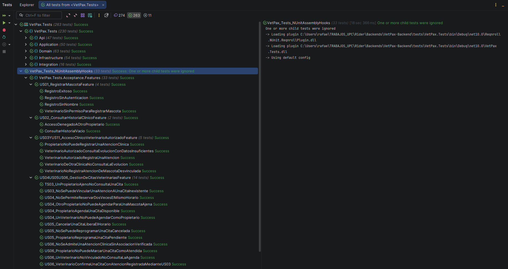

*Figura 7.7. Evidencia de ejecución de escenarios BDD en Rider; 33 pruebas de aceptación exitosas en el registro compartido.*

Los seis archivos `.feature` registrados en el backend suman **38 escenarios escritos** (RegisterPet 4, GetClinicalHistory 2, VeterinaryClinicalAccess 5, AppointmentManagement 14, ClinicManagement 8 y MedicationTreatmentApi 5). Su contenido se relaciona principalmente con otros módulos del producto; no se atribuye a US15, US16, US19 ni TS11 sin una prueba de correspondencia.

#### 7.2.1.5. Execution Evidence for Sprint Review

La Landing Page de VetPax se encuentra publicada en **Netlify**, con evidencias de ejecución capturadas en navegador. Su dirección es **https://vetpax-landing-page.netlify.app/**. El material aportado comprende **13 capturas de escritorio y 11 capturas de dispositivos móviles**. Se seleccionan imágenes representativas para evitar duplicación, manteniendo la colección íntegra en las carpetas de evidencia.

| Historia | Flujo o vista | Evidencia | Observación |
|---|---|---|---|
| US15 | Sección Hero y propuesta de valor | `Web/1.png` | Contenido principal y presentación de los dos segmentos |
| US15 | Beneficios y explicación de VetPax | `Web/2.png`, `Web/3.png`, `Web/4.png` | Estructura informativa renderizada |
| US15 | Información para propietarios y clínicas | `Web/5.png`, `Web/6.png` | Contenido para ambos segmentos |
| US15 | Ecosistema, testimonios y preguntas frecuentes | `Web/7.png` a `Web/11.png` | Secciones complementarias en navegador |
| US15 | Layout responsive y menú móvil | `Mobil/1.jpeg` a `Mobil/11.jpeg` | Disposición adaptable y menú desplegado |
| US19 | Presentación de botones CTA | `Web/12.png`, `Mobil/1.jpeg` | Botones visibles; no acreditan por sí solos redirección externa |

**Evidencia 1. Pantalla inicial en escritorio.**

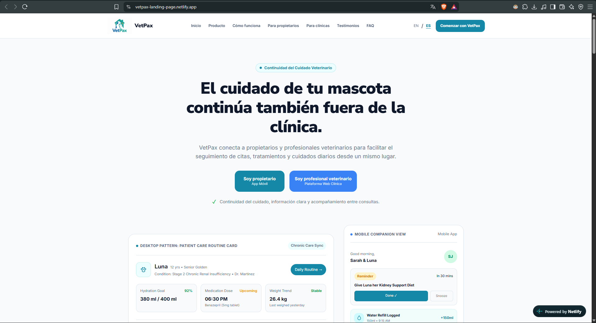

*Figura 7.8. Hero de VetPax: mensaje de valor, acceso informativo para propietarios y profesionales.*

**Evidencia 2. Presentación y beneficios del producto.**

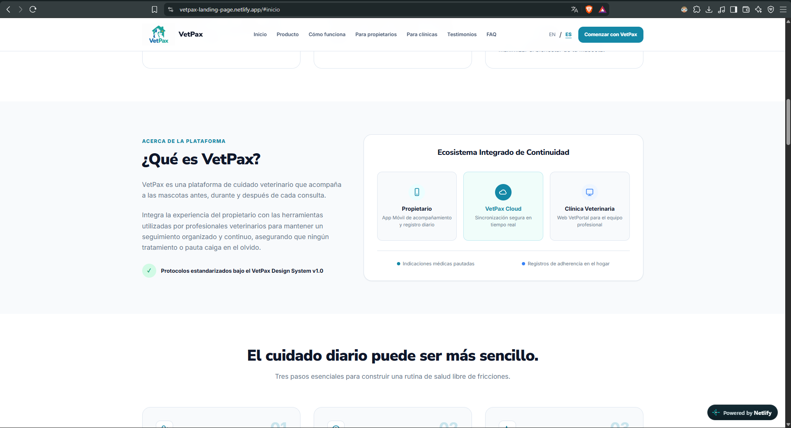

*Figura 7.9. Sección «¿Qué es VetPax?» y presentación del ecosistema.*

**Evidencia 3. Funcionalidades para propietarios.**

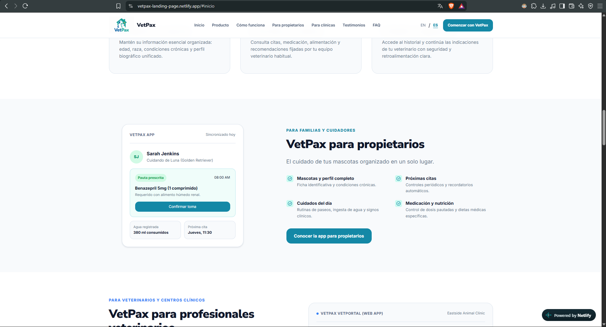

*Figura 7.10. Sección dirigida a propietarios de mascotas.*

**Evidencia 4. Funcionalidades para clínicas.**

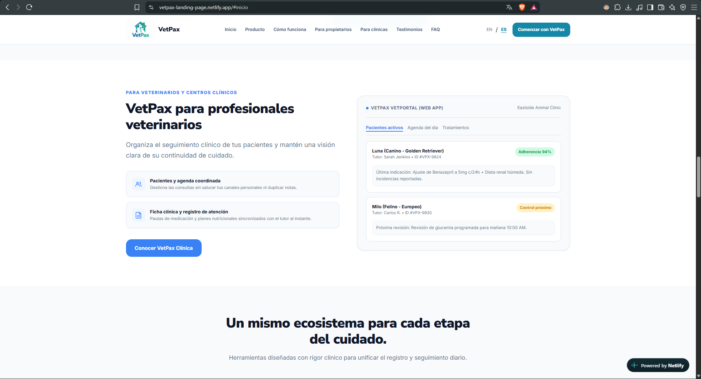

*Figura 7.11. Sección dirigida a profesionales veterinarios.*

**Evidencia 5. Llamadas a la acción (CTA).**

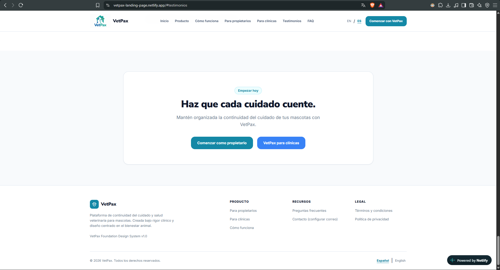

*Figura 7.12. Botones orientados a los dos segmentos; evidencia visual de US19, distinta de la verificación de sus destinos.*

**Evidencia 6. Presentación móvil.**

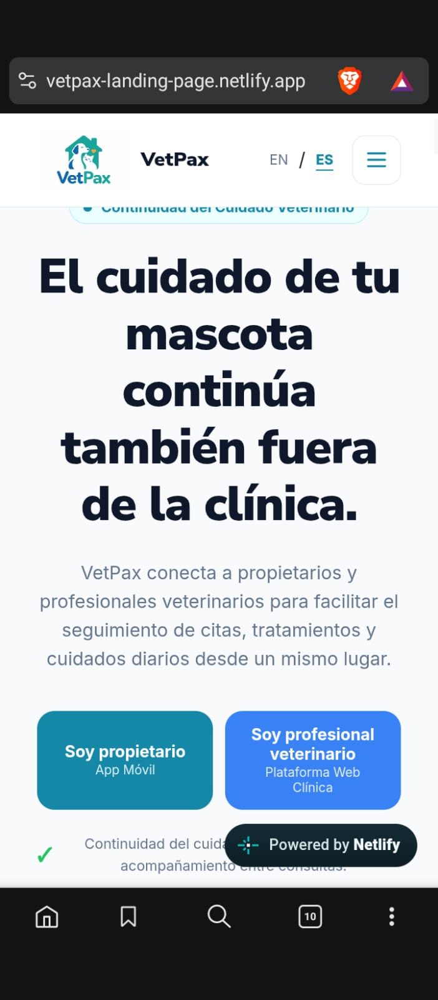

*Figura 7.13. Vista móvil de la sección principal.*

**Evidencia 7. Interacción en móvil.**

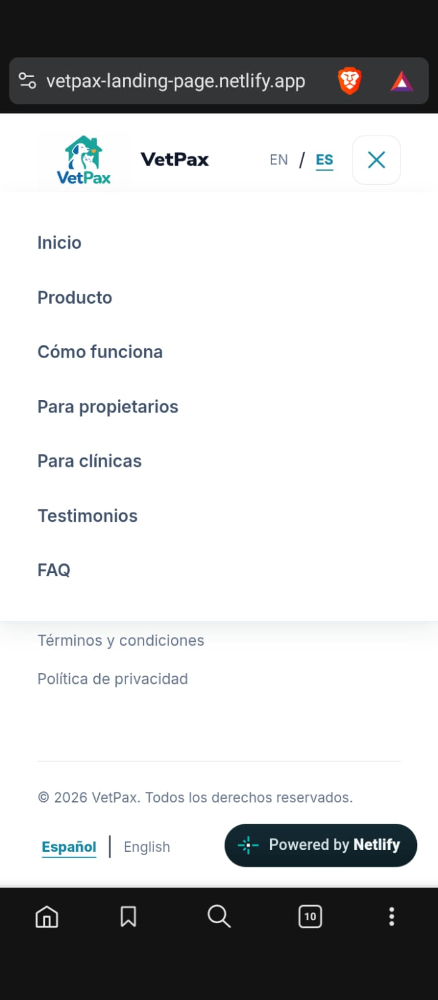

*Figura 7.14. Estado desplegado del menú de navegación en dispositivo móvil.*

Estas capturas **sí acreditan la ejecución visual de la Landing Page publicada y su adaptación responsive**. No contienen un envío de formulario de interesados ni el resultado de una API TS11. Tampoco se adjuntó un video de demostración con intervalos temporales en el material revisado; por ello, no se inventa una URL ni un timing.

#### 7.2.1.6. Services Documentation Evidence for Sprint Review

VetPax cuenta con una API REST en ASP.NET Core/.NET 10 y documentación OpenAPI/Swagger. Se dispone de código de controladores que define métodos, rutas, entradas y posibles respuestas, así como de commits que integran Swagger con Keycloak. La documentación se referencia en **https://vetpax-api-production.up.railway.app/swagger/** y el documento OpenAPI en **https://vetpax-api-production.up.railway.app/openapi/v1.json**. Esas son direcciones configuradas en el proyecto; la disponibilidad en tiempo real y la ejecución interactiva `Try it out` no pudieron comprobarse con las capturas recibidas.

**Tabla. Contratos REST identificados en el backend (contexto técnico del proyecto, no endpoints de TS11)**

| Módulo | Método HTTP | Endpoint | Parámetros / Request | Response definido | Documentación |
|---|---|---|---|---|---|
| Identity Access Management | POST | `/api/v1/auth/register` | Body: RegisterAccountRequest | 201, 400, 409, 429 | Swagger / OpenAPI |
| Identity Access Management | GET | `/api/v1/auth/me` | Bearer Token | 200: AuthenticatedUserResponse; 401, 403 | Swagger / OpenAPI |
| Identity Access Management | GET | `/api/v1/auth/me/permissions` | Bearer Token | 200: MyPermissionsResponse; 401, 403 | Swagger / OpenAPI |
| Pet Clinical Care | POST | `/api/v1/pets` | Body: RegisterPetRequest | 201: RegisterPetResponse; 400, 401, 403 | Swagger / OpenAPI |
| Pet Clinical Care | GET | `/api/v1/pets` | Bearer Token | 200: lista de PetResponse; 401, 403 | Swagger / OpenAPI |
| Pet Clinical Care | GET | `/api/v1/pets/{petId}` | Path: petId (GUID) | 200: PetResponse; 400, 401, 403, 404 | Swagger / OpenAPI |
| Pet Clinical Care | GET | `/api/v1/pets/{petId}/clinical-records` | Path: petId (GUID) | 200: ClinicalHistoryResponse; 400, 401, 403, 404 | Swagger / OpenAPI |
| Pet Clinical Care | POST | `/api/v1/pets/{petId}/clinical-records` | Path: petId; Query: clinicId y parámetros de atención; Body: datos clínicos | 201: RegisterClinicalAttentionResponse; 400, 401, 403, 404, 409 | Swagger / OpenAPI |
| Pet Clinical Care | GET | `/api/v1/pets/{petId}/evolution` | Path: petId; Query: clinicId | 200; 400, 401, 403, 404 | Swagger / OpenAPI |
| Clinic Management | GET | `/api/v1/clinics` | Query: page, pageSize | 200, 400 | Swagger / OpenAPI |
| Clinic Management | GET | `/api/v1/clinics/{clinicId}/veterinarians` | Path: clinicId (GUID) | 200, 400, 404 | Swagger / OpenAPI |
| Clinic Management | GET | `/api/v1/clinics/{clinicId}/patients` | Path: clinicId (GUID) | 200: ClinicPatientsResponse | Swagger / OpenAPI |
| Appointment Management | POST | `/api/v1/appointments` | Body: ScheduleAppointmentRequest | 201: AppointmentResponse; 400, 401, 403, 409 | Swagger / OpenAPI |
| Appointment Management | PATCH | `/api/v1/appointments/{appointmentId}` | Path: appointmentId; Body: PatchAppointmentRequest | 200: AppointmentResponse; 400, 401, 403, 404, 409 | Swagger / OpenAPI |
| Appointment Management | GET | `/api/v1/appointments/availability` | Query: clinicId, veterinarianId, date | 200: AvailableSlotsData; 400, 401, 403 | Swagger / OpenAPI |
| Appointment Management | GET | `/api/v1/appointments/agenda` | Query: clinicId, from, to | 200: AppointmentAgendaResponse; 400, 401, 403 | Swagger / OpenAPI |
| Medication Treatment | POST | `/api/v1/pets/{petId}/medication-plans` | Path: petId; Body: CreateMedicationPlanRequest | 201: MedicationPlanResponse; 400, 401, 403, 404, 409 | Swagger / OpenAPI |
| Medication Treatment | GET | `/api/v1/pets/{petId}/medication-plans` | Path: petId | 200: lista de MedicationPlanResponse; 401, 403, 404 | Swagger / OpenAPI |
| Medication Treatment | POST | `/api/v1/medication-doses/{doseId}/administrations` | Path: doseId; Body: RegisterMedicationAdministrationRequest | 201: MedicationAdministrationResponse; 400, 401, 403, 404, 409 | Swagger / OpenAPI |
| Nutrition Management | GET | `/api/v1/pets/{petId}/feeding-plans/active` | Path: petId | 200: FeedingPlanResponse; 401, 403, 404 | Swagger / OpenAPI |
| Nutrition Management | PUT | `/api/v1/feeding-plans/{planId}` | Path: planId; Body: UpdateFeedingPlanRequest | 200: FeedingPlanResponse; 400, 401, 403, 404, 409 | Swagger / OpenAPI |
| Adherence Gamification | GET | `/api/v1/me/adherence` | Bearer Token | 200: AdherenceResponse; 401, 403 | Swagger / OpenAPI |

Los códigos HTTP anteriores representan **respuestas declaradas por los controladores**; no son respuestas capturadas tras invocar los servicios durante el sprint. Como ejemplo de contrato, `POST /api/v1/pets` recibe `RegisterPetRequest` (`Name`, `Species`, `BirthDate`, `Breed` opcional, `Sex` opcional) y declara `201 Created` con un `RegisterPetResponse` que contiene `PetId` y `ClinicalRecordId`. Esta operación corresponde a la gestión de mascotas, **no al registro de interesados**.

**Ejemplo documentado de request y response (contrato declarado; no es una llamada ejecutada).** En `PetClinicalCare`, el DTO `RegisterPetRequest` declara `Name`, `Species`, `BirthDate`, `Breed` y `Sex`. El proyecto serializa los enums como texto y `RegisterPetResponse` devuelve `PetId` y `ClinicalRecordId`. Un ejemplo compatible con esas estructuras es:

**Request:** `POST /api/v1/pets` (requiere autorización según el controlador).

```json
{
  "name": "Luna",
  "species": "Dog",
  "birthDate": "2020-06-15",
  "breed": "Golden Retriever",
  "sex": "Female"
}
```

**Response ilustrativo de `201 Created`:**

```json
{
  "petId": "00000000-0000-0000-0000-000000000001",
  "clinicalRecordId": "00000000-0000-0000-0000-000000000002"
}
```

Los identificadores son de ejemplo: esta transcripción representa la estructura de los recursos C# disponibles, **no una respuesta real de producción** ni una operación correspondiente a TS11.

**Commits de soporte a Swagger y API en producción:** Estos cambios se realizaron en `feature/authentication`, se integraron a `develop` mediante PR y aparecen posteriormente en `main`. La siguiente tabla señala la **rama de implementación original**, no solo la rama que los contiene tras el merge.

| Repository | Branch | Commit ID | Descripción | Fecha UTC |
|---|---|---|---|---|
| VetPax-Backend | feature/authentication | [9eb3f34e](https://github.com/1ASI0728-2620-9061-G4-PawVitalTech/VetPax-Backend/commit/9eb3f34e654c78c7f021facaf11a82b3cad3b6be) | Configuración OpenAPI con Keycloak | 2026-11-04 |
| VetPax-Backend | feature/authentication | [2083b93f](https://github.com/1ASI0728-2620-9061-G4-PawVitalTech/VetPax-Backend/commit/2083b93f6732bde5d3da6e5cff6e1de8a70131f4) | Integración de logout con Swagger UI | 2026-11-04 |
| VetPax-Backend | feature/authentication | [ce37bde5](https://github.com/1ASI0728-2620-9061-G4-PawVitalTech/VetPax-Backend/commit/ce37bde5c5f6b9bbed4d631fa34741f352551105) | URL pública de API para Swagger fuera de desarrollo | 2026-11-04 |

**Trazabilidad específica de TS11.** Esta historia contempla una API de registro de interesados provenientes de la Landing Page. El código revisado no permite identificar una ruta específica de esa funcionalidad. No corresponde renombrar otro endpoint para presentarlo como cumplimiento de TS11 ni inventar su request/response.

#### 7.2.1.7. Software Deployment Evidence for Sprint Review

**La Landing Page ya está desplegada en Netlify.** Su URL es **https://vetpax-landing-page.netlify.app/** y las capturas `Landing_Page/Web/*` y `Landing_Page/Mobil/*` muestran la aplicación publicada y visualizada desde navegadores. Esto corrige expresamente la afirmación anterior de que faltaban URL o capturas del sitio.

**Infraestructura backend observada en Railway.** Las capturas del entorno `production` muestran los servicios `VetPax-Api`, `keycloak`, `MySQL` y `Postgres` con estado *Online* en el momento de la captura. El backend incluye Dockerfile versionado y configuración de documentación Swagger. MySQL se usa para los datos del negocio, mientras que Postgres respalda la persistencia del proveedor de identidad Keycloak.

| Elemento | Plataforma | Evidencia | Estado sustentado |
|---|---|---|---|
| Landing Page | Netlify | URL publicada y 24 capturas de navegador | Sitio visible en las capturas proporcionadas |
| VetPax-Api | Railway / Docker | `Railway/3.png`, commit `47bcbab1` | Servicio mostrado Online en Railway |
| MySQL | Railway | `Railway/3.png` | Servicio mostrado Online en Railway |
| Keycloak | Railway | `Railway/3.png` y capturas KeyCloak | Servicio y configuración de identidad documentados |
| PostgreSQL para Keycloak | Railway | `Railway/3.png` | Servicio mostrado Online en Railway |
| Swagger / OpenAPI | ASP.NET Core API | Rutas configuradas y commits de Swagger | Configuración documentada; ejecución interactiva no adjuntada |


*Figura 7.15. Servicios del backend e identidad en el entorno de producción de Railway.*


*Figura 7.16. Configuración del servicio VetPax-Api. No se deben divulgar contraseñas ni secretos en las imágenes finales.*

**Secuencia de despliegue documentada:** versionamiento del código en GitHub; construcción de la Landing Page mediante Vite y publicación de contenido estático en Netlify; construcción del backend con Dockerfile; configuración de servicios y variables protegidas en Railway; despliegue de `VetPax-Api`, MySQL, Keycloak y Postgres; y comprobación del estado indicado por la plataforma. La URL del sitio y las capturas respaldan la ejecución visual de la Landing Page, pero no sustituyen las pruebas de integración del formulario TS11.

#### 7.2.1.8. Team Collaboration Insights during Sprint

La coordinación de PawVital Tech se realizó mediante Discord para la planificación, Jira para el seguimiento del Sprint Backlog y GitHub para el versionamiento y la integración de código. La reunión de planificación contó con **cuatro integrantes**. Las historias `VET-6`, `VET-43`, `VET-44` y `VET-45` figuran en la columna **Finalizado** del tablero de Jira y están vinculadas a la cuenta de Rafael Dominguez; este dato describe la asignación registrada, no la autoría exclusiva de todo el código.


*Figura 7.17. Tablero «VetPax - Sprint 1» con las cuatro historias comprometidas en la columna Finalizado.*

**Análisis de GitHub Insights.** Se incorporan las ocho capturas del archivo `Insight.zip`: tres de Backend, dos de Landing Page y tres de Web Application. Los paneles *Pulse* muestran el intervalo **12 de octubre – 12 de noviembre de 2026**; los paneles *Contributors* utilizan una ventana de **tres meses**, con actividad agrupada semanalmente. Ambos intervalos son más amplios que el Sprint 1 (**27 de octubre – 13 de noviembre**), y las capturas se realizaron antes de su fecha de finalización. Por ello, las cifras que siguen son **datos de las capturas**, no velocidades ni métricas definitivas del sprint.

| Repositorio | Capturas | Datos observados en GitHub Insights | Interpretación |
|---|---|---|---|
| Backend | `Insight/Backend/1.png`, `2.png`, `3.png` | 19 pull requests fusionados; 1 autor y 43 commits hacia `main` (44 considerando todas las ramas) en el resumen mostrado; gráfico de red de ramas | Evidencia de integración mediante PR y trabajo versionado. El gráfico de contribuciones identifica a `Radv2005` para la ventana representada. |
| Landing Page | `Insight/Landing/1.png`, `2.png` | 0 pull requests fusionados y 1 commit de 1 autor en la ventana mostrada | Refleja la incorporación inicial de la Landing Page al repositorio; el commit identificado es del 23/10/2026, antes del inicio del sprint. |
| Web Application | `Insight/Web/1.png`, `2.png`, `3.png` | 1 pull request fusionado, 46 commits y 4 autores en el resumen mostrado | Evidencia de colaboración en ramas de funcionalidades y un proceso de integración. |
| Mobile Application | No se adjuntaron imágenes de Insights | No hay métricas de Insights verificables en este paquete | No se extrapolan cifras ni se interpreta como ausencia de desarrollo móvil. Los commits de Mobile se documentan en 7.2.1.3. |

**Insights del Backend**

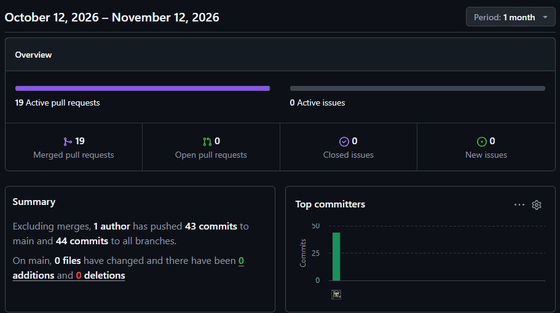

*Figura 7.18. Resumen de actividad del repositorio Backend: 19 pull requests fusionados y commits registrados en el período seleccionado.*

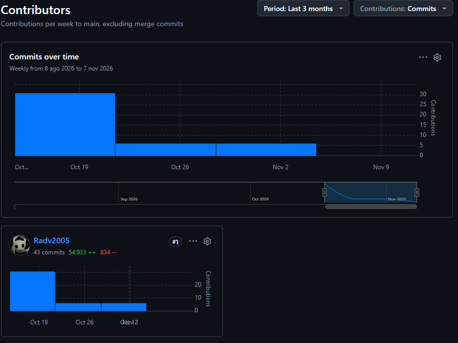

*Figura 7.19. Actividad semanal y contribución identificada de Radv2005; el gráfico abarca un período distinto del Sprint 1.*

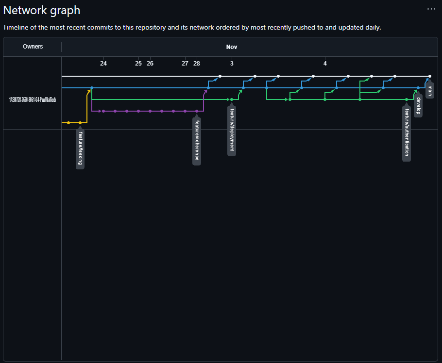

*Figura 7.20. Gráfico de red del repositorio Backend que permite identificar divergencias e integraciones de ramas.*

**Insights de la Landing Page**

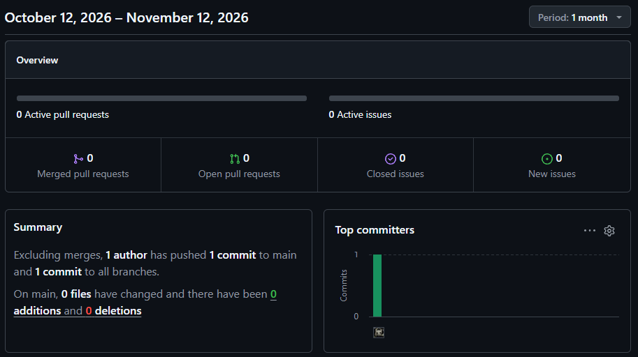

*Figura 7.21. Resumen de la Landing Page: un commit y ningún pull request fusionado en la ventana mostrada.*

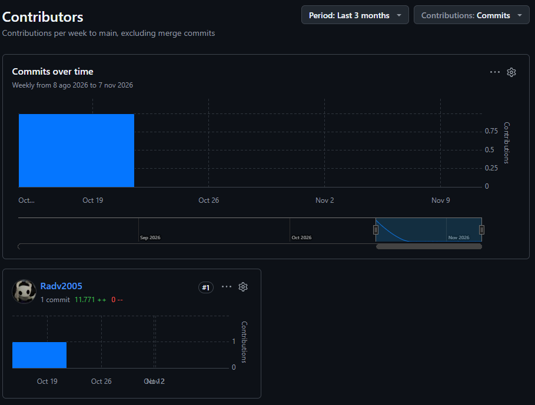

*Figura 7.22. Contribución registrada en Landing Page; el commit inicial antecede a la planificación del Sprint 1.*

**Insights de Web Application**

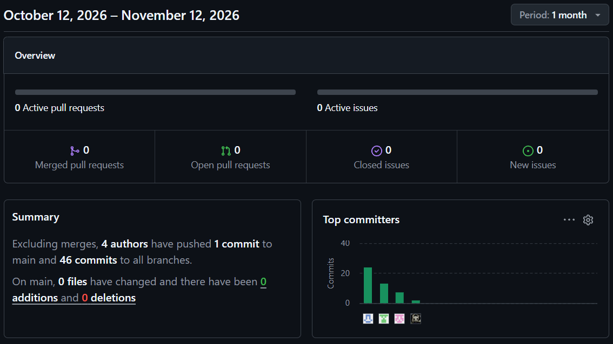

*Figura 7.23. Resumen de actividad de Web Application durante el período seleccionado.*

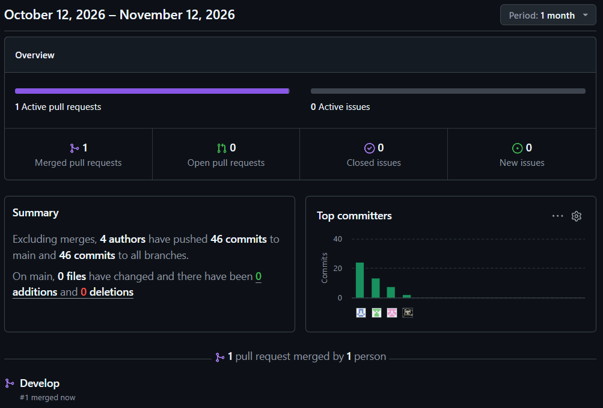

*Figura 7.24. Evidencia de un pull request fusionado y 46 commits atribuidos a cuatro autores en el resumen de GitHub.*

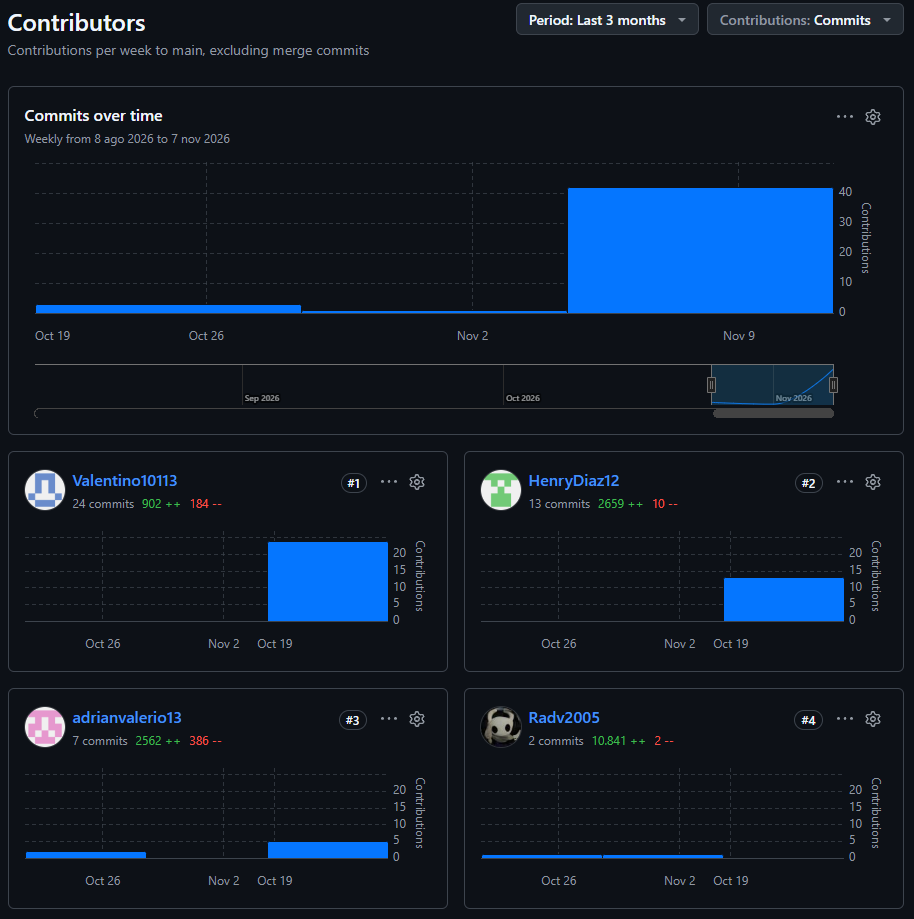

*Figura 7.25. Distribución de contribuciones de Web Application entre Valentino10113, HenryDiaz12, adrianvalerio13 y Radv2005.*

El panel *Contributors* de Web Application identifica **24 commits de Valentino10113, 13 de HenryDiaz12, 7 de adrianvalerio13 y 2 de Radv2005**. En conjunto suman 46 commits para el período y criterio de GitHub mostrado; no deben tratarse como horas trabajadas, Story Points ni trabajo dedicado exclusivamente a EP06.


**Colaboración y trazabilidad del Sprint 1.** Jira registra el compromiso funcional de cuatro historias y GitHub proporciona una historia de contribuciones, ramas y fusiones. Las capturas de Insights refuerzan la evidencia de trabajo colaborativo en la aplicación web y de integración técnica en el backend, sin demostrar por sí solas la implementación del formulario US16 o del endpoint TS11. La finalización administrativa de una historia, una actividad de commit y la aprobación de sus criterios de aceptación son tres evidencias diferentes, que se documentan por separado en este capítulo.

